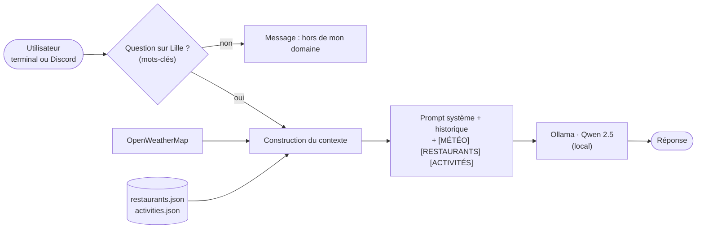

<div align="center">


# Eliza Lille — l'assistant local qui connaît Lille

**Chatbot qui conseille restaurants et sorties à Lille selon la météo du moment.
Le modèle de langage tourne en local avec Ollama : pas de clé OpenAI, pas de données envoyées à un tiers.**

[](https://github.com/Lois5959/ELIZA/actions/workflows/ci.yml)


</div>

<p align="center">
  
</p>

---

## 🎯 En bref

Une question à Eliza → elle récupère la **météo réelle** de Lille, choisit des **restaurants** ou des
**activités** adaptés (en intérieur s'il pleut, en terrasse s'il fait beau), puis demande à un **LLM local**
de rédiger une réponse courte et naturelle.

| | |
|---|---|
| 🧠 **IA locale** | Qwen 2.5 (1,5 milliard de paramètres) servi par Ollama |
| 🌦️ **Météo en direct** | API OpenWeatherMap |
| 🍽️ **500 restaurants · 500 activités** | Filtrés par cuisine, budget et météo |
| 💬 **Deux interfaces** | Terminal et bot Discord (`!eliza`), une conversation par utilisateur |
| 🛡️ **Garde-fous** | Questions hors sujet refusées **avant** d'appeler le modèle, `!reset` pour effacer son historique |
| 🌐 **Landing page** | Site React bilingue pour présenter le bot ([`lillemove/`](lillemove/)) |

---

## 🧠 Comment ça marche



Le modèle ne cherche rien lui-même : **le code choisit les données** (restaurants filtrés, activités compatibles
avec la météo) et les place dans le prompt. Le modèle ne fait que rédiger. C'est le principe du
**RAG** (*retrieval-augmented generation*) : moins d'inventions et des réponses limitées au sujet.

---

## ⚡ Démarrage rapide

**Prérequis** : Python 3.10+, Node.js 18+, [Ollama](https://ollama.com/) et une clé
[OpenWeatherMap](https://openweathermap.org/api) gratuite (facultative).

```bash
git clone https://github.com/Lois5959/ELIZA.git
cd ELIZA
pip install -r requirements.txt
ollama pull qwen2.5:1.5b

cp .env.example .env      # puis renseigner OPENWEATHER_API_KEY (et DISCORD_TOKEN pour le bot)

make run                  # assistant dans le terminal
make discord              # bot Discord : !eliza <question>, !reset
```

Sans clé météo, Eliza le dit clairement au lieu d'inventer le temps qu'il fait.

<details>
<summary><b>⚙️ Variables d'environnement</b></summary>

<br>

| Variable | Rôle | Défaut |
|---|---|---|
| `OPENWEATHER_API_KEY` | Météo en direct | vide → météo indisponible |
| `DISCORD_TOKEN` | Token du bot Discord | requis pour `make discord` |
| `OLLAMA_HOST` | Adresse du serveur Ollama | `http://localhost:11434` |
| `OLLAMA_MODEL` | Modèle utilisé | `qwen2.5:1.5b` |

</details>

<details>
<summary><b>🌐 Lancer la landing page</b></summary>

<br>

```bash
cd lillemove
npm ci
npm run dev        # http://localhost:5173
```

React 19, Vite, Tailwind CSS et Motion. Détails dans [`lillemove/README-landing-page.md`](lillemove/README-landing-page.md).

</details>

---

## 📊 Les données

Les restaurants et les activités sont **générés** par deux scripts Node.js (noms, cuisines, quartiers, prix,
horaires, météo compatible). Ce sont des **données de démonstration** : seuls les 27 lieux connus
(Palais des Beaux-Arts, Citadelle, Opéra...) existent vraiment.

```bash
make fetch        # régénère data/*.json (graine fixe : toujours le même résultat)
```

## 🧪 Tests

```bash
pip install -r requirements-dev.txt
pytest -q
```

Le modèle est **simulé** : les tests tournent sans Ollama ni réseau. Ils vérifient le refus des questions
hors sujet, le contexte envoyé au modèle, le message quand Ollama est absent, la limite de l'historique,
les filtres et la météo. La CI vérifie aussi que `data/` correspond aux générateurs et que la landing page compile.

## 📚 Documentation

- [Stratégie](docs/strategie.md) · [Personas](docs/personas.md) · [Parcours utilisateur](docs/user_journey.md)
- [Évaluation éthique](docs/Ethical-Assessment.md) (effet ELIZA, RGPD, biais)
- [Architecture des fichiers](mermaid.md)

## 📁 Structure

```
.
├── main.py                 # assistant dans le terminal
├── discord_bot.py          # bot Discord (!eliza, !reset)
├── llm_client.py           # contexte, historique, appel à Ollama
├── prompts.py              # prompt système et filtre hors sujet
├── weather.py              # météo OpenWeatherMap
├── restaurant_loader.py    # recherche de restaurants
├── activity_loader.py      # activités selon la météo
├── data/                   # restaurants et activités (générés)
├── scripts/                # générateurs Node.js
├── lillemove/              # landing page React
├── tests/                  # pytest
└── docs/                   # stratégie, personas, éthique
```

---

<div align="center">

Projet d'équipe du module **B-AIA-210** · Bachelor Epitech Lille
**Loïs-Elie Ekollo** · Mateo

</div>
